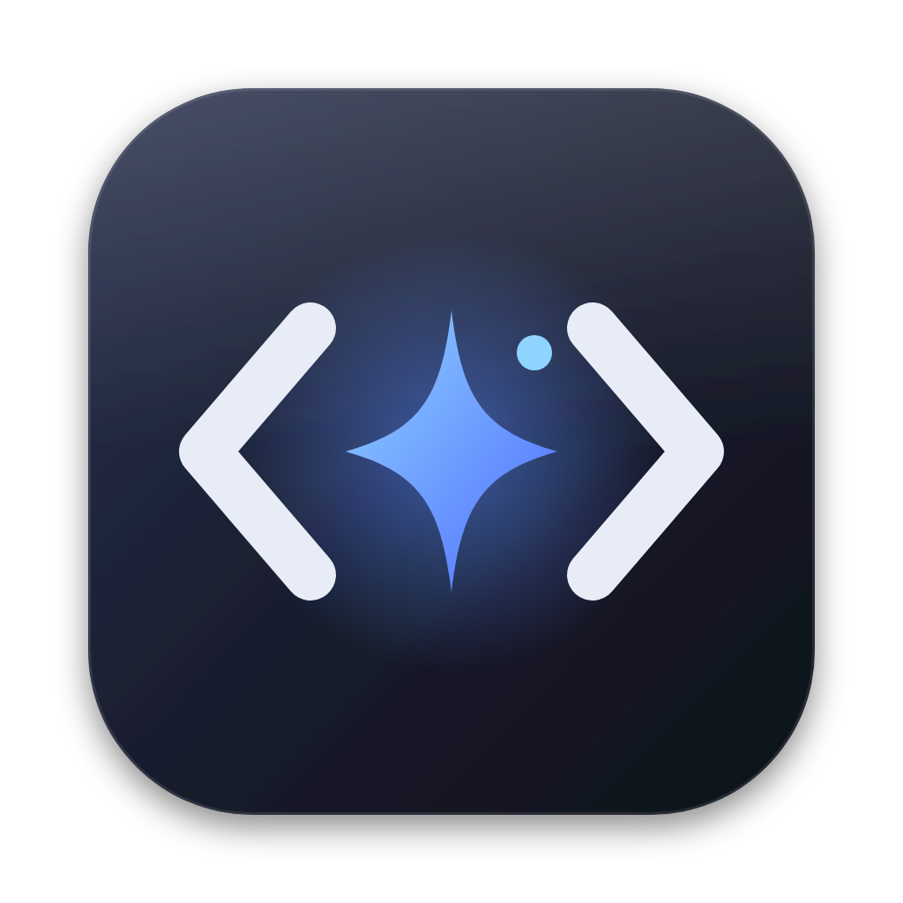
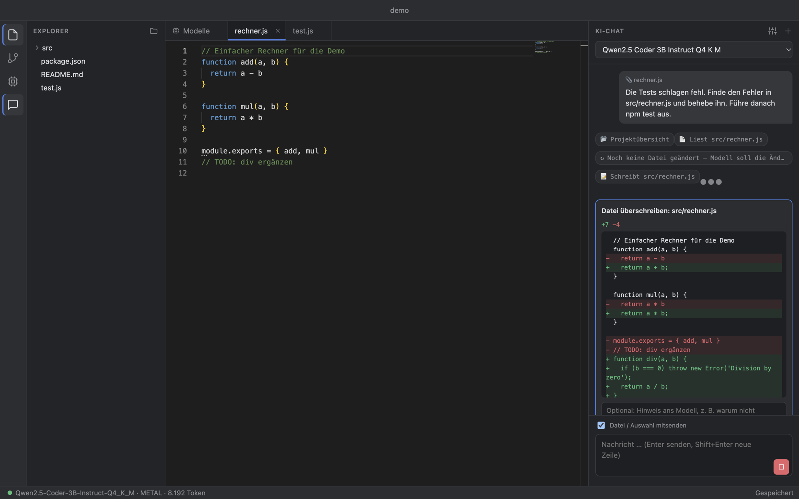
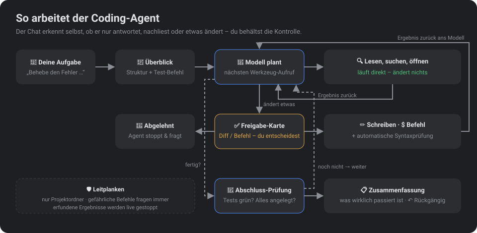
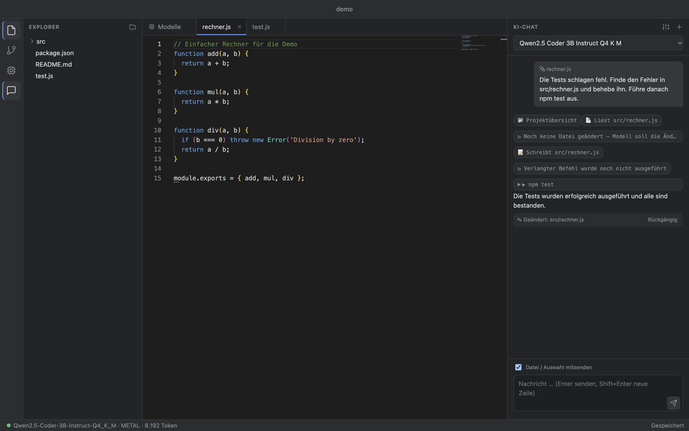
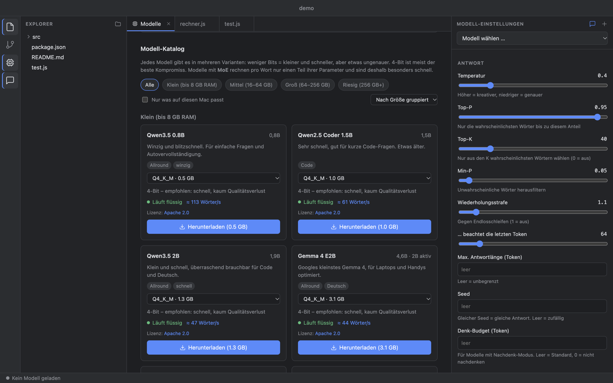
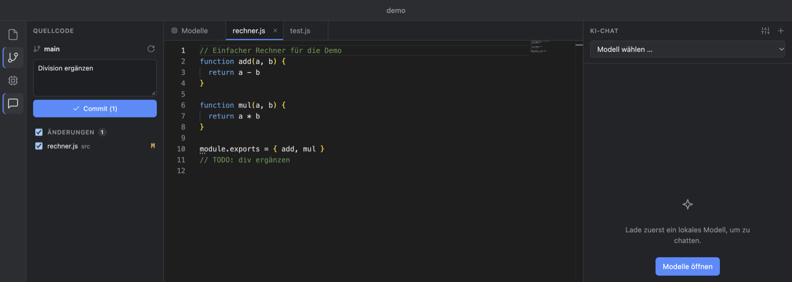
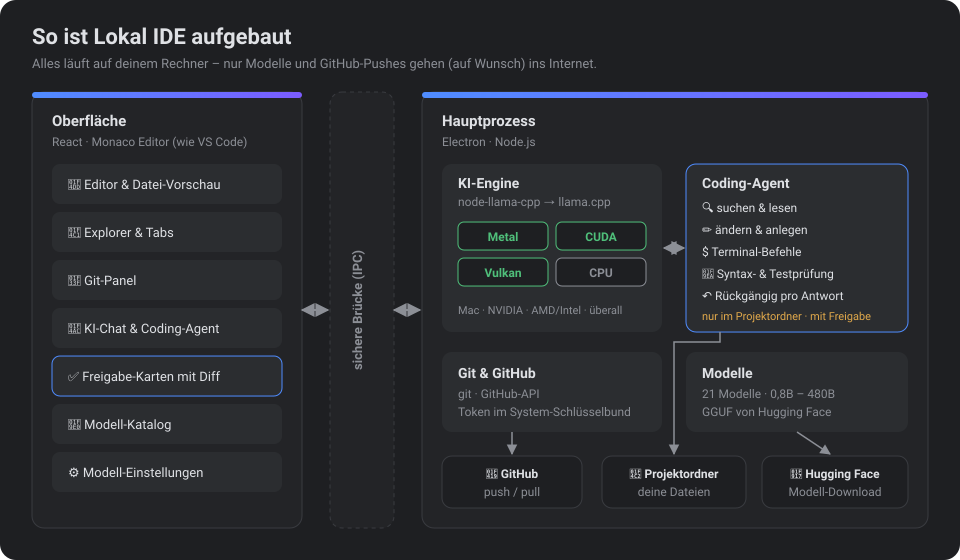

<p align="center">
  
</p>

<h1 align="center">Lokal IDE</h1>

<p align="center">
  <b>Code-Editor mit eingebauter KI, die komplett auf deinem Rechner läuft.</b><br>
  Chat, Coding-Agent, Git und GitHub – ohne Cloud, ohne API-Schlüssel, ohne Abo.
</p>

<p align="center">
  
  
  
  
</p>

<p align="center">
  
</p>

---

## Was kann Lokal IDE?

| | |
| --- | --- |
| 🤖 **Coding-Agent** | Gib eine Aufgabe („Behebe den Fehler und führe die Tests aus“) – der Agent sucht im Projekt, liest Code, ändert Dateien und startet Terminal-Befehle. Jede Änderung siehst du vorher als Diff und gibst sie frei. |
| 🧠 **Erkennt selbst, was du willst** | Kein Umschalten zwischen Modi: Allgemeine Fragen beantwortet er direkt, Projektfragen durch Nachlesen, Aufträge als Agent. |
| 💻 **Lokale KI** | Modelle laufen über [llama.cpp](https://github.com/ggml-org/llama.cpp) direkt in der App – mit Metal (Mac), CUDA (NVIDIA), Vulkan (AMD/Intel) oder auf der CPU. |
| 📚 **21 Modelle, 0,8B – 480B** | Qwen 3.5/3.6/3.8, Gemma 4, gpt-oss, Qwen3 Coder … jeweils von 2-Bit bis zum unquantisierten Original – mit Tempo-Schätzung für deinen Rechner. |
| 📝 **Editor wie VS Code** | Monaco-Editor mit Syntax-Highlighting für alle gängigen Sprachen, Vorschau für Bilder, PDFs, Audio und Video. |
| 🌿 **Git & GitHub** | Änderungen ansehen, Dateien auswählen, committen, pushen, pullen – und neue Repositories direkt auf GitHub veröffentlichen. |
| ⚙️ **Alles einstellbar** | Temperatur, Top-P/K, Kontextgröße, GPU-Backend, System-Prompt, Freigabe-Regeln für den Agent … |
| 💾 **Merkt sich alles** | Beim nächsten Start sind Ordner und offene Dateien wieder da. |

## Der Coding-Agent

<p align="center">
  
</p>

Kleine lokale Modelle sind nicht so zuverlässig wie große Cloud-Modelle. Deshalb ist der Agent mit vielen Sicherungen gebaut:

- **Du gibst frei:** Dateiänderungen und Befehle erscheinen als Karte mit Diff. Erlauben, ablehnen (optional mit Hinweis ans Modell) oder „für diesen Chat immer erlauben“.
- **Leitplanken:** Der Agent arbeitet nur im geöffneten Projektordner. Gefährliche Befehle (`sudo`, `rm`, `git push`, Pfade außerhalb des Projekts …) werden **immer** nachgefragt.
- **Ehrlichkeit:** Erfindet das Modell Ergebnisse („Test erfolgreich!“), bevor etwas ausgeführt wurde, wird die Antwort live gestoppt und der echte Schritt ausgeführt. Am Ende steht nur, was wirklich passiert ist.
- **Selbstkontrolle:** Nach jedem Schreiben wird die Syntax geprüft (JavaScript, JSON, Python, Shell). Vor dem Abschluss prüft die App, ob Tests grün sind und alle verlangten Dateien existieren – sonst macht der Agent weiter.
- **Rückgängig:** Unter jeder Antwort lassen sich alle Änderungen mit einem Klick zurücknehmen.
- **Robust bei kleinen Modellen:** Werkzeug-Aufrufe werden auch erkannt, wenn das Modell kein sauberes JSON schreibt; Änderungen gehen auch über Zeilennummern statt exakten Text.

<p align="center">
  
  <br><sub>Echter Lauf mit Qwen2.5 Coder 3B auf einem Mac mit M3 und 8 GB RAM: Fehler gefunden, Funktion ergänzt, <code>npm test</code> grün.</sub>
</p>

## Modelle

<p align="center">
  
</p>

Jedes Modell gibt es in mehreren Varianten. Weniger Bits = kleiner und schneller, aber etwas ungenauer – **4-Bit ist meist der beste Kompromiss**. Modelle mit **MoE** (z. B. „35B A3B“) rechnen pro Wort nur einen kleinen Teil ihrer Parameter und sind deshalb fast so schnell wie kleine Modelle.

| Dein Rechner | Empfehlung |
| --- | --- |
| 8 GB RAM (z. B. MacBook Air) | Qwen3.5 4B oder Gemma 4 E4B in 4-Bit |
| 16–32 GB RAM | Qwen3.5 9B, gpt-oss 20B, Gemma 4 26B A4B |
| 32–64 GB RAM / NVIDIA mit 24 GB | Qwen3.6 35B A3B, Qwen3 Coder 30B A3B, Qwen3.8 27B |
| 64–256 GB (Mac Studio, Workstation) | Qwen3 Coder Next 80B, gpt-oss 120B, Qwen3.8 Flash-Next |
| 256 GB+ | Qwen3.5 397B, Qwen3 Coder 480B |

Die App zeigt für jede Variante, ob sie auf **deinen** Rechner passt und wie viele Wörter pro Sekunde ungefähr zu erwarten sind – bei NVIDIA-Karten inklusive Hinweis, wenn ein Teil auf die CPU ausweichen muss.

## Git & GitHub

<p align="center">
  
</p>

Repository anlegen, Dateien auswählen, committen (⌘↩), pushen und pullen. Für GitHub reicht ein Zugangs-Token – er wird im Schlüsselbund des Systems gespeichert (macOS-Schlüsselbund bzw. libsecret unter Linux).

## So ist die App aufgebaut

<p align="center">
  
</p>

| Bereich | Datei | Aufgabe |
| --- | --- | --- |
| Hauptprozess | [`src/main/index.ts`](src/main/index.ts) | Fenster, Menü, Dateizugriff, IPC |
| KI-Engine | [`src/main/llm.ts`](src/main/llm.ts) | Modell laden, Backend-Wahl (Metal/CUDA/Vulkan/CPU), Chat, Agent-Schleife |
| Agent | [`src/main/agent.ts`](src/main/agent.ts), [`agentTools.ts`](src/main/agentTools.ts) | Werkzeuge, Freigaben, Leitplanken, Syntaxprüfung, Rückgängig |
| Hardware | [`src/main/hardware.ts`](src/main/hardware.ts) | Passt das Modell? Wie schnell läuft es? |
| Modelle | [`src/main/models.ts`](src/main/models.ts), [`catalog.ts`](src/main/catalog.ts) | Katalog, mehrteilige Downloads, Installation |
| Git | [`src/main/git.ts`](src/main/git.ts) | Git-Befehle, GitHub-API |
| Oberfläche | [`src/renderer/src/`](src/renderer/src/) | React + Monaco: Editor, Explorer, Chat, Freigabe-Karten, Katalog, Git |

## Installieren & starten

Voraussetzung: [Node.js](https://nodejs.org) 22 oder neuer.

```bash
npm install
npm run dev
```

Beim ersten Start unter „Modelle“ ein Modell herunterladen (z. B. **Qwen3.5 4B**), einen Ordner öffnen und im Chat loslegen.

### Linux

```bash
npm install          # lädt automatisch die llama.cpp-Bausteine für CPU, Vulkan und CUDA
npm run dev
```

- **NVIDIA (CUDA):** aktueller NVIDIA-Treiber und [CUDA Toolkit](https://developer.nvidia.com/cuda-downloads) 12.4+ (oder 13.1+).
- **AMD / Intel (Vulkan):** Vulkan-Treiber der Distribution (z. B. `mesa-vulkan-drivers`).
- Ohne passende GPU läuft alles auf der CPU. Das Backend lässt sich in den Modell-Einstellungen festlegen.
- GitHub-Token landen im Schlüsselbund (libsecret); ist der nicht installiert, in `~/.git-credentials`.

> Die Linux-Unterstützung ist neu: Code und Build-Konfiguration sind vorbereitet, getestet ist bisher aber nur macOS. Rückmeldungen sind willkommen.

## Als App bauen

| Plattform | Befehl | Ergebnis |
| --- | --- | --- |
| macOS | `npm run app` | `~/Applications/Lokal IDE.app` (signiert) |
| Linux | `npm run app:linux` (auf Linux ausführen) | `dist/Lokal-IDE-<version>-x64.AppImage` und `.tar.gz` |

Auf dem Mac wird bewusst außerhalb des Projektordners signiert: Liegt das Projekt auf einem iCloud-synchronisierten Schreibtisch, hängt macOS sofort wieder Datei-Attribute an und `codesign` bricht ab.

Modelle liegen unter `~/Library/Application Support/Lokal IDE/models` (macOS) bzw. `~/.config/Lokal IDE/models` (Linux).

## Ideen für später

- Inline-Vervollständigung im Editor (Ghost-Text)
- Integriertes Terminal
- Projektweiter Kontext (Embeddings über den geöffneten Ordner)
- OpenAI-kompatibler lokaler Server, damit auch andere Tools die Modelle nutzen können

## Open Source & Lizenzen

Lokal IDE baut auf diesen Open-Source-Projekten auf:

| Projekt | Wofür | Lizenz |
| --- | --- | --- |
| [llama.cpp](https://github.com/ggml-org/llama.cpp) | Führt die Sprachmodelle lokal aus (Metal-GPU auf Apple Silicon) | MIT |
| [node-llama-cpp](https://github.com/withcatai/node-llama-cpp) | Anbindung von llama.cpp an Node.js/Electron, Funktionsaufrufe | MIT |
| [Electron](https://github.com/electron/electron) | Desktop-App (enthält Chromium und Node.js) | MIT |
| [Monaco Editor](https://github.com/microsoft/monaco-editor) | Code-Editor (derselbe wie in VS Code) | MIT |
| [@monaco-editor/react](https://github.com/suren-atoyan/monaco-react) | Monaco in React | MIT |
| [React](https://github.com/facebook/react) | Oberfläche | MIT |
| [Vite](https://github.com/vitejs/vite), [electron-vite](https://github.com/alex8088/electron-vite) | Build | MIT |
| [electron-builder](https://github.com/electron-userland/electron-builder) | Mac-App packen | MIT |
| [TypeScript](https://github.com/microsoft/TypeScript) | Sprache | Apache 2.0 |

Die vollständigen Lizenztexte aller mitgelieferten Pakete (121 Stück, alle freizügig: MIT, ISC, Blue Oak, Apache 2.0) stehen in [THIRD_PARTY_LICENSES.txt](THIRD_PARTY_LICENSES.txt). Die Datei wird bei `npm run app` neu erzeugt (`scripts/licenses.mjs`), mit der App ausgeliefert und ist dort über **Hilfe → Open-Source-Lizenzen** erreichbar.

### Modelle

Die Modelle sind nicht Teil der App – sie werden erst auf Wunsch von Hugging Face geladen. Der Katalog ([src/main/catalog.ts](src/main/catalog.ts)) wird mit `node scripts/update-catalog.mjs` direkt aus Hugging Face erzeugt: 21 Modelle von 0,8B bis 480B Parametern, jeweils in mehreren Varianten (2-Bit bis unquantisiertes 16-Bit-Original). Die GGUF-Dateien stammen von [unsloth](https://huggingface.co/unsloth), [ggml-org](https://huggingface.co/ggml-org) und [bartowski](https://huggingface.co/bartowski); es gilt jeweils die Lizenz des Originalmodells:

| Modelle | Lizenz | Kommerziell |
| --- | --- | --- |
| Qwen3.5 (0.8B–397B), Qwen3.6, Qwen3.8 27B, Qwen3 Coder (30B, Next, 480B), Qwen2.5 Coder 1.5B/7B | Apache 2.0 | ja |
| Gemma 4 (E2B, E4B, 12B, 26B A4B, 31B) | Apache 2.0 | ja |
| gpt-oss 20B / 120B (OpenAI) | Apache 2.0 | ja |
| **Qwen2.5 Coder 3B** | [Qwen Research License](https://huggingface.co/Qwen/Qwen2.5-Coder-3B-Instruct/blob/main/LICENSE) | **nein** – nur Forschung/Ausprobieren |
| **Qwen3.8 Flash-Next 177B** | [Qwen Community License 1.0](https://huggingface.co/Qwen/Qwen3.8-Flash-Next/blob/main/LICENSE) | privat/intern ja; **wer kommerziell ein KI-Coding-Produkt (wie diese IDE) anbietet, braucht eine eigene Lizenz** |

Die Lizenz steht auch auf jeder Modell-Karte in der App.
