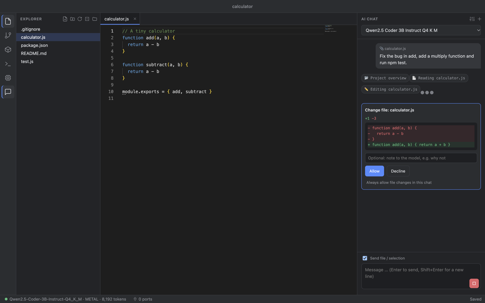
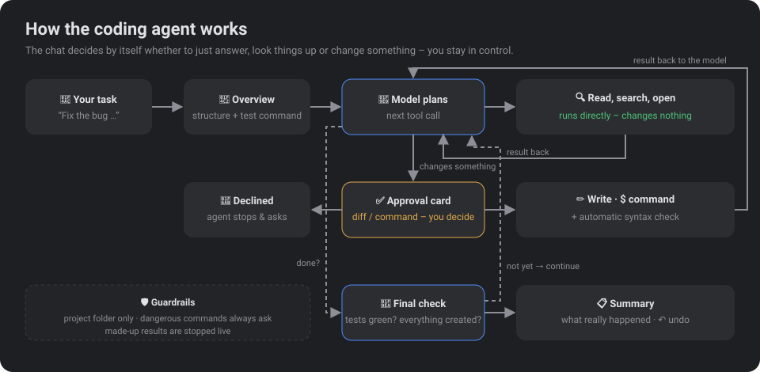
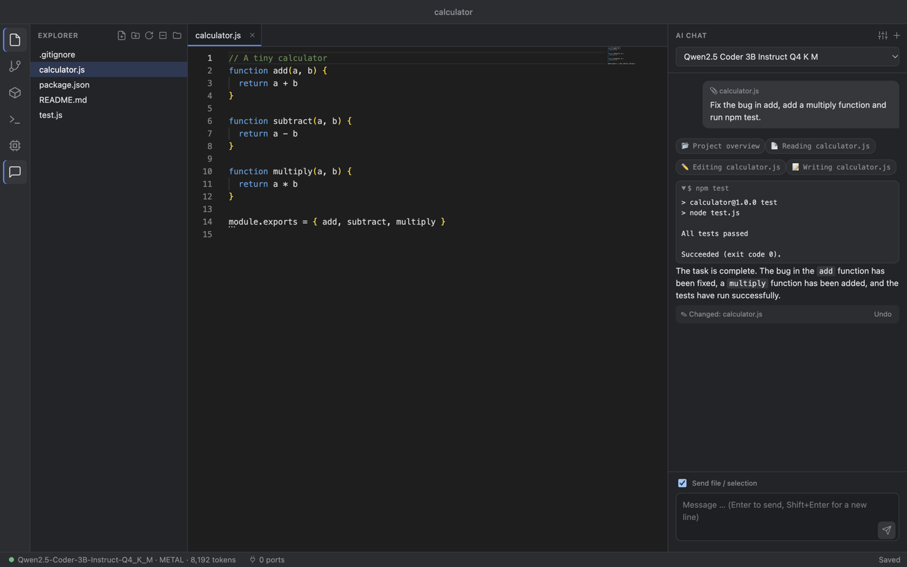
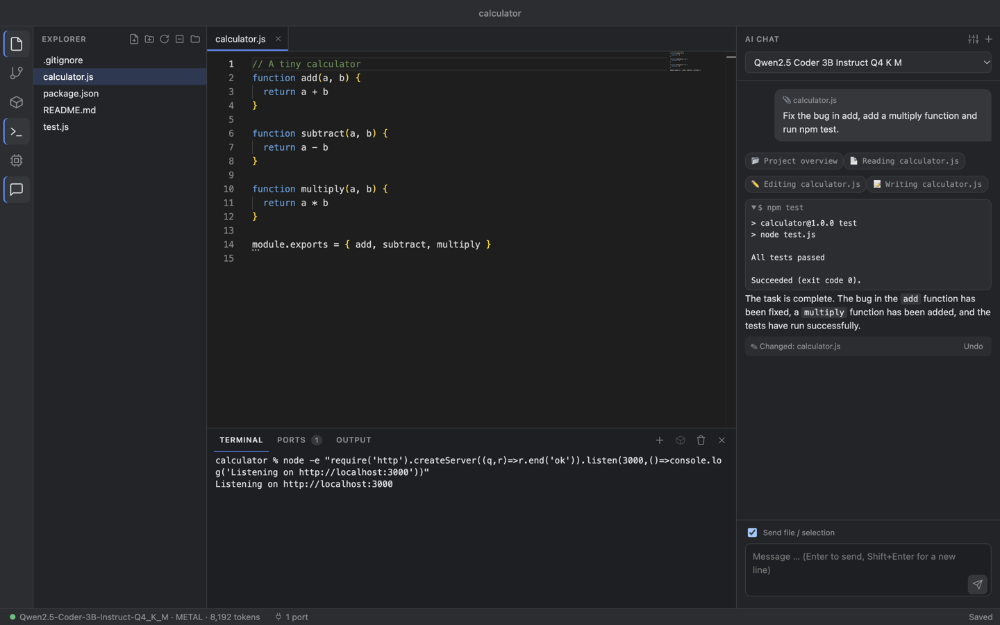
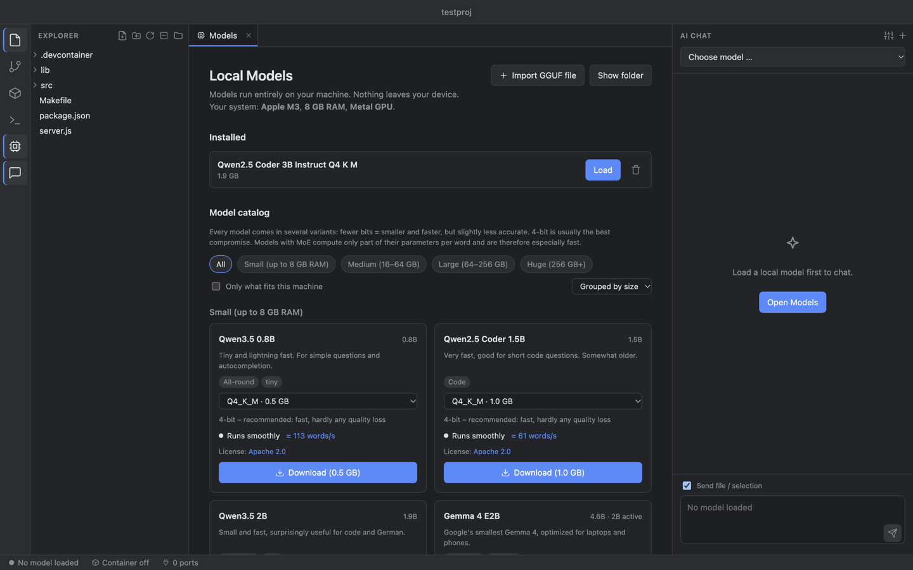
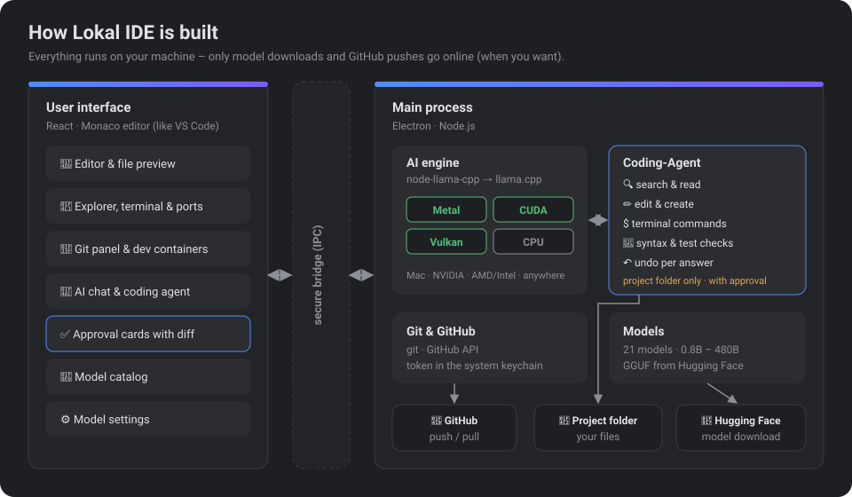

<p align="center">
  
</p>

<h1 align="center">Lokal IDE</h1>

<p align="center">
  <b>A code editor with built-in AI that runs entirely on your machine.</b><br>
  Chat, coding agent, terminal, dev containers, Git and GitHub – no cloud, no API keys, no subscription.
</p>

<p align="center">
  
  
  
  
  
</p>

<p align="center"><b>Install with one command</b> (macOS &amp; Linux):</p>

```bash
curl -fsSL https://raw.githubusercontent.com/constantin-loesch/Lokal-IDE/main/scripts/install.sh | sh
```

<p align="center">
  
</p>

---

## What can Lokal IDE do?

| | |
| --- | --- |
| 🤖 **Coding agent** | Give it a task (“Fix the bug and run the tests”) – the agent searches the project, reads code, edits files and runs terminal commands. You see every change as a diff first and approve it. |
| 🧠 **Figures out what you want** | No mode switching: general questions get a direct answer, project questions are looked up, tasks are handled as an agent. |
| 💻 **Local AI** | Models run inside the app via [llama.cpp](https://github.com/ggml-org/llama.cpp) – with Metal (Mac), CUDA (NVIDIA, including Jetson), Vulkan (AMD/Intel) or on the CPU. |
| 📚 **21 models, 0.8B – 480B** | Qwen 3.5/3.6/3.8, Gemma 4, gpt-oss, Qwen3 Coder … each from 2-bit up to the unquantized original – with a speed estimate for your machine. |
| 📝 **Editor like VS Code** | Monaco editor with syntax highlighting for all common languages, previews for images, PDFs, audio and video. |
| 📁 **Explorer** | Create files and folders (even `folder/subfolder/file.ts` in one go), rename (F2), move to trash, copy paths, open in terminal. Changes from outside show up immediately. |
| 🖥️ **Integrated terminal** | A real shell (zsh/bash) with colors and multiple terminals – local or inside the dev container. <kbd>⌃\`</kbd> toggles it. |
| 🔌 **Ports** | When a program in the terminal starts a server, its port appears automatically. Ports from the dev container are forwarded to `localhost` – one click opens them in the browser. |
| 📦 **Dev containers** | Create a `devcontainer.json` in a dialog (language, build tools, ports), then build, start, stop and rebuild the container – via the official Dev Container CLI, compatible with VS Code. |
| 🔨 **Build tasks** | Detects npm/pnpm/yarn scripts, Make, Cargo, Go, Maven, Gradle, CMake, Python, .NET and Docker – one click runs them in the terminal, locally or in the container. |
| 🌿 **Git & GitHub** | View changes, select files, commit, push, pull – and publish new repositories directly on GitHub. |
| ⬆️ **Updates inside the app** | When a new version is on GitHub, a notice lists the changes. One click downloads and builds it in the background, a restart installs it. |
| 🌍 **English & German** | The app follows your system language; you can also pick it in the settings. |
| ⚙️ **Everything adjustable** | Temperature, top-p/k, context size, GPU backend, system prompt, approval rules for the agent … |
| 💾 **Remembers everything** | Folder and open files are back on the next start. |

## The coding agent

<p align="center">
  
</p>

Small local models are not as reliable as large cloud models. That's why the agent comes with many safeguards:

- **You approve:** file changes and commands appear as a card with a diff. Allow, decline (optionally with a note to the model) or “always allow in this chat”.
- **Guardrails:** the agent only works inside the opened project folder. Dangerous commands (`sudo`, `rm`, `git push`, paths outside the project …) are **always** asked for.
- **Honesty:** if the model makes up results (“Tests passed!”) before anything was run, the answer is stopped live and the real step is executed. In the end only what actually happened is reported.
- **Self-checks:** after every write the syntax is checked (JavaScript, JSON, Python, shell). Before finishing, the app checks whether tests are green and all requested files exist – otherwise the agent continues.
- **Undo:** all changes of an answer can be reverted with one click.
- **Robust with small models:** tool calls are recognized even when the model doesn't write clean JSON; edits also work via line numbers instead of exact text.

<p align="center">
  
  <br><sub>A real run with Qwen2.5 Coder 3B on a Mac with M3 and 8 GB RAM: bug fixed, function added, <code>npm test</code> green.</sub>
</p>

## Terminal, ports & dev containers

<p align="center">
  
</p>

**Terminal** – the terminal icon on the left or <kbd>⌃\`</kbd> opens a terminal in the project folder at the bottom (<kbd>⌃⇧\`</kbd> opens another one). It's a real shell via [node-pty](https://github.com/microsoft/node-pty) and [xterm.js](https://github.com/xtermjs/xterm.js): colors, full-screen programs like `vim` or `htop`, <kbd>⌘C</kbd> copies the selection, <kbd>⌘K</kbd> clears. Terminals keep running while the panel is hidden.

**Ports** – the app watches which programs started from its terminals open a TCP port (`lsof` or `ss`) and lists them in the *Ports* tab with a link to open them. Inside the dev container, listening ports are detected automatically (`/proc/net/tcp`) and forwarded to `localhost` – if the port is taken, the next free one is used. Add your own forwards at the bottom of the tab.

<p align="center">
  
</p>

**Dev containers** – in the *Container & Build* view (cube icon):

1. **Create:** the dialog suggests an image that fits the project (Node, Python, Go, Rust, Java, C/C++, .NET …), plus build tools as [features](https://containers.dev/features) (Node, Python, Go, Rust, Java + Maven + Gradle, gcc/make/CMake, Docker-in-Docker, GitHub CLI), ports and a command to run after creation (e.g. `npm install`). You see the `devcontainer.json` live before it is written.
2. **Start / rebuild / stop / delete:** runs on the official [Dev Container CLI](https://github.com/devcontainers/cli) – the same technology VS Code uses, so existing configurations with a Dockerfile or Docker Compose work too. The *Output* tab shows the progress.
3. **Work:** “Terminal in container” opens a shell inside the container (as `remoteUser`, in the workspace folder). Build tasks can run either *locally* or *in the container*.

Requires Docker: [Docker Desktop](https://www.docker.com/products/docker-desktop/), OrbStack, Colima or Docker Engine on Linux.

## Models

<p align="center">
  
</p>

Every model comes in several variants. Fewer bits = smaller and faster, but slightly less accurate – **4-bit is usually the best compromise**. Models with **MoE** (e.g. “35B A3B”) compute only a small part of their parameters per word and are therefore almost as fast as small models.

| Your machine | Recommendation |
| --- | --- |
| 8 GB RAM (e.g. MacBook Air) | Qwen3.5 4B or Gemma 4 E4B in 4-bit |
| 16–32 GB RAM | Qwen3.5 9B, gpt-oss 20B, Gemma 4 26B A4B |
| 32–64 GB RAM / NVIDIA with 24 GB / Jetson AGX Orin 64 GB | Qwen3.6 35B A3B, Qwen3 Coder 30B A3B, Qwen3.8 27B |
| 64–256 GB (Mac Studio, workstation) | Qwen3 Coder Next 80B, gpt-oss 120B, Qwen3.8 Flash-Next |
| 256 GB+ | Qwen3.5 397B, Qwen3 Coder 480B |

The app shows for every variant whether it fits **your** machine and roughly how many words per second to expect – for NVIDIA cards including a hint when part of it has to fall back to the CPU.

## Git & GitHub

<p align="center">
  
</p>

Create a repository, select files, commit (⌘↩), push and pull. For GitHub an access token is enough – it is stored in the system keychain (macOS keychain or libsecret on Linux).

## Updates

At build time the app remembers its Git commit and the source folder (`~/.lokal-ide` when installed with the script). Shortly after start and then every four hours it asks GitHub whether there are newer commits on `main` (**Help → Check for Updates …** checks right away).

If there are, a notice with the list of changes appears at the bottom right:

1. **Install** – in the background: `git pull` in the source folder, `npm install`, rebuild the app. You can keep working; “Details” shows the output.
2. **Restart now** – the app quits, the new version replaces the old one (macOS: in the same place, re-signed, the Dock icon stays linked; Linux: the AppImage) and starts again.

“Later” hides the notice until the next new version; the status bar keeps showing “Update available”. If the source folder has uncommitted changes, the update stops instead of overwriting them. For developers: with `npm run dev` an update only fetches the new code; `LOKAL_IDE_BUILD_COMMIT=<sha> npm run build` pretends an older state to test the notice.

## Languages

The app is available in **English** and **German**. By default it follows the system language; in the model settings (sliders icon in the chat) you can choose *Automatic*, *English* or *Deutsch* – the window reloads in the new language. English is the source language in the code; German translations live in [`src/shared/i18n.de.ts`](src/shared/i18n.de.ts).

## How the app is built

<p align="center">
  
</p>

| Area | File | Purpose |
| --- | --- | --- |
| Main process | [`src/main/index.ts`](src/main/index.ts) | Window, menu, file access, IPC |
| AI engine | [`src/main/llm.ts`](src/main/llm.ts) | Load models, backend choice (Metal/CUDA/Vulkan/CPU), chat, agent loop |
| Agent | [`src/main/agent.ts`](src/main/agent.ts), [`agentTools.ts`](src/main/agentTools.ts) | Tools, approvals, guardrails, syntax checks, undo |
| Hardware | [`src/main/hardware.ts`](src/main/hardware.ts) | Does the model fit? How fast does it run? (incl. Jetson & unified memory) |
| Models | [`src/main/models.ts`](src/main/models.ts), [`catalog.ts`](src/main/catalog.ts) | Catalog, multi-part downloads, installation |
| Git | [`src/main/git.ts`](src/main/git.ts) | Git commands, GitHub API |
| Terminal | [`src/main/terminal.ts`](src/main/terminal.ts) | Pseudo terminals (node-pty), local or via `devcontainer exec` |
| Ports | [`src/main/ports.ts`](src/main/ports.ts) | Detect ports, forward from the container to `localhost` |
| Dev containers | [`src/main/devcontainer.ts`](src/main/devcontainer.ts) | Templates, Docker status, start/rebuild/stop via the Dev Container CLI |
| Build tasks | [`src/main/tasks.ts`](src/main/tasks.ts) | Detects scripts and build systems in the project |
| Updates | [`src/main/updater.ts`](src/main/updater.ts) | Compare with GitHub, pull & rebuild, swap on restart |
| Translations | [`src/shared/i18n.ts`](src/shared/i18n.ts), [`i18n.de.ts`](src/shared/i18n.de.ts) | English source texts, German dictionary |
| UI | [`src/renderer/src/`](src/renderer/src/) | React + Monaco + xterm.js: editor, explorer, terminal, ports, containers, chat, approval cards, catalog, Git |

## Install & run

### With one command

```bash
curl -fsSL https://raw.githubusercontent.com/constantin-loesch/Lokal-IDE/main/scripts/install.sh | sh
```

The script ([`scripts/install.sh`](scripts/install.sh)) checks the requirements, downloads the source to `~/.lokal-ide`, installs the dependencies and builds the app:

- **macOS:** `~/Applications/Lokal IDE.app`
- **Linux:** `~/.local/bin/lokal-ide` (AppImage) plus an entry in the app menu

After that the app updates itself (see [Updates](#updates)); running the script again works too. Requirements: `git`, and on Linux additionally `build-essential` and `python3` (for the terminal). For dev containers also Docker. **Node.js 22+** is needed for building – if it is missing or older, the script downloads its own Node.js to `~/.local/share/lokal-ide/node` (no `sudo`, the system Node stays untouched). This works on macOS and Linux with x64 or ARM64.

### For development

```bash
git clone https://github.com/constantin-loesch/Lokal-IDE.git
cd Lokal-IDE
npm install
npm run dev
```

On first start, download a model under “Models” (e.g. **Qwen3.5 4B**), open a folder and start chatting.

### Linux

```bash
sudo apt install build-essential python3   # for the terminal (node-pty gets compiled)
npm install          # downloads the llama.cpp binaries for CPU, Vulkan and CUDA automatically
npm run dev
```

- **NVIDIA (CUDA):** current NVIDIA driver and [CUDA Toolkit](https://developer.nvidia.com/cuda-downloads) 12.4+ (or 13.1+).
- **AMD / Intel (Vulkan):** your distribution's Vulkan driver (e.g. `mesa-vulkan-drivers`).
- Without a suitable GPU everything runs on the CPU. The backend can be set in the model settings.
- GitHub tokens go to the keyring (libsecret); if that isn't installed, to `~/.git-credentials`.

**NVIDIA Jetson (Orin, Xavier, Thor) and DGX Spark:** the install script detects the device and builds llama.cpp once **with CUDA for exactly this GPU** (takes 10–40 minutes, [`scripts/build-llama-cuda.sh`](scripts/build-llama-cuda.sh)). The app recognizes the **unified memory** – on an AGX Orin with 64 GB the full 64 GB are available for models, with a realistic speed estimate (204.8 GB/s bandwidth). Flash attention is on by default there.

- Requirement: the CUDA toolkit from JetPack (`sudo apt install nvidia-jetpack`), JetPack 5 or 6. JetPack 4 (Ubuntu 18.04) is too old for Node.js 22.
- For full performance: `sudo nvpmodel -m 0` (power mode MAXN) and `sudo jetson_clocks`.
- The CUDA build is only repeated on updates when the llama.cpp version changes. Rebuild by hand: `LOKAL_IDE_CUDA_REBUILD=1 sh scripts/build-llama-cuda.sh` in the source folder (`~/.lokal-ide`).
- If the CUDA build fails, the AI keeps running on the CPU – the installation doesn't abort.

> Linux support is new: code and build configuration are in place, but so far only macOS has been tested thoroughly. Feedback is welcome.

## Building the app

| Platform | Command | Result |
| --- | --- | --- |
| macOS | `npm run app` | `~/Applications/Lokal IDE.app` (signed) |
| Linux | `npm run app:linux` (run on Linux) | `dist/Lokal-IDE-<version>-<arch>.AppImage` and `.tar.gz` |

On the Mac the app is deliberately signed outside the project folder: if the project lives on an iCloud-synced Desktop, macOS immediately re-attaches file attributes and `codesign` aborts.

Models are stored in `~/Library/Application Support/Lokal IDE/models` (macOS) or `~/.config/Lokal IDE/models` (Linux).

## Ideas for later

- Inline completion in the editor (ghost text)
- Moving files via drag & drop in the explorer
- Project-wide context (embeddings over the opened folder)
- OpenAI-compatible local server so other tools can use the models too

## Open source & licenses

Lokal IDE builds on these open source projects:

| Project | Used for | License |
| --- | --- | --- |
| [llama.cpp](https://github.com/ggml-org/llama.cpp) | Runs the language models locally | MIT |
| [node-llama-cpp](https://github.com/withcatai/node-llama-cpp) | Binds llama.cpp to Node.js/Electron, function calling | MIT |
| [Electron](https://github.com/electron/electron) | Desktop app (contains Chromium and Node.js) | MIT |
| [Monaco Editor](https://github.com/microsoft/monaco-editor) | Code editor (the same as in VS Code) | MIT |
| [@monaco-editor/react](https://github.com/suren-atoyan/monaco-react) | Monaco in React | MIT |
| [React](https://github.com/facebook/react) | User interface | MIT |
| [xterm.js](https://github.com/xtermjs/xterm.js) | Terminal rendering | MIT |
| [node-pty](https://github.com/microsoft/node-pty) | Real pseudo terminals | MIT |
| [Dev Container CLI](https://github.com/devcontainers/cli) | Building and starting dev containers | MIT |
| [Vite](https://github.com/vitejs/vite), [electron-vite](https://github.com/alex8088/electron-vite) | Build | MIT |
| [electron-builder](https://github.com/electron-userland/electron-builder) | Packaging the app | MIT |
| [TypeScript](https://github.com/microsoft/TypeScript) | Language | Apache 2.0 |

The full license texts of all bundled packages (126, all permissive: MIT, ISC, Blue Oak, Apache 2.0, MPL 2.0 as an option) are in [THIRD_PARTY_LICENSES.txt](THIRD_PARTY_LICENSES.txt). The file is regenerated on `npm run app` (`scripts/licenses.mjs`), shipped with the app and available there under **Help → Open Source Licenses**.

### Models

The models are not part of the app – they are only downloaded from Hugging Face on request. The catalog ([src/main/catalog.ts](src/main/catalog.ts)) is generated directly from Hugging Face with `node scripts/update-catalog.mjs`: 21 models from 0.8B to 480B parameters, each in several variants (2-bit up to the unquantized 16-bit original). The GGUF files come from [unsloth](https://huggingface.co/unsloth), [ggml-org](https://huggingface.co/ggml-org) and [bartowski](https://huggingface.co/bartowski); the license of the original model applies in each case:

| Models | License | Commercial use |
| --- | --- | --- |
| Qwen3.5 (0.8B–397B), Qwen3.6, Qwen3.8 27B, Qwen3 Coder (30B, Next, 480B), Qwen2.5 Coder 1.5B/7B | Apache 2.0 | yes |
| Gemma 4 (E2B, E4B, 12B, 26B A4B, 31B) | Apache 2.0 | yes |
| gpt-oss 20B / 120B (OpenAI) | Apache 2.0 | yes |
| **Qwen2.5 Coder 3B** | [Qwen Research License](https://huggingface.co/Qwen/Qwen2.5-Coder-3B-Instruct/blob/main/LICENSE) | **no** – research/trying out only |
| **Qwen3.8 Flash-Next 177B** | [Qwen Community License 1.0](https://huggingface.co/Qwen/Qwen3.8-Flash-Next/blob/main/LICENSE) | private/internal yes; **offering a commercial AI coding product (like this IDE) requires a separate license** |

The license is also shown on every model card in the app.
